# 活力坐标（Vitality Coordinates）店内移动收银系统
## 产品需求文档 (PRD - Product Requirement Document)

> **当前版本**：V1.4  
> **文档密级**：内部产品规范  
> **面向对象**：产品经理、门店运营、业务管理层、UI/UX 设计师、测试团队、合规审计  
> **适用终端**：PDA 智能手持终端 / 智能手机 / 移动 POS 收银机  
> **对应原型**：[手机端店内收银.html](file:///c:/文件/谷歌AI/老百姓/新店型/手机端店内收银.html)

---

## 目录
1. [文档概述](#1-文档概述)
2. [业务流程图](#2-业务流程图)
3. [功能规格详述](#3-功能规格详述)
   - 3.1 [工作台初始态与场景定位](#31-工作台初始态与场景定位)
   - 3.2 [会员身份智能识别与胶囊交互](#32-会员身份智能识别与胶囊交互)
   - 3.3 [药品检索与国家追溯码一键核验](#33-药品检索与国家追溯码一键核验)
   - 3.4 [电子处方单智能管理与追溯码 1:1 逐盒合规采集](#34-电子处方单智能管理与追溯码-11-逐盒合规采集)
   - 3.5 [购物车流转与价格动态联动](#35-购物车流转与价格动态联动)
   - 3.6 [促销套餐自动化首选机制](#36-促销套餐自动化首选机制)
   - 3.7 [多元支付结算与反扫闭环](#37-多元支付结算与反扫闭环)
   - 3.8 [交易完成与下一单自动化重置](#38-交易完成与下一单自动化重置)
4. [业务异常矩阵与防御策略](#4-业务异常矩阵与防御策略)

---

## 1. 文档概述

### 1.1 版本说明
| 版本号 | 生效日期 | 状态 | 规格说明 |
| :---: | :---: | :---: | :--- |
| **V1.4** | 2026-10-29 | **当前版本** | 基于“活力坐标”新店型规范构建的移动收银整体方案，涵盖初始空置装载、会员智能路由与胶囊交互、20位国家追溯码一键核验入车、电子处方突出患者/诊断与多单累加提单、处方药1:1逐盒强合规采集校验、促销套餐默认优选抵扣、聚合后置反扫顾客码、储值卡自适应扣减及6位安全PIN鉴权等全流程功能。 |

### 1.2 产品定位
基于移动手持终端（PDA/手机）的新一代智慧药房移动收银系统，集成“货架旁移动收银”、“电子处方快速核验”、“国家药品电子追溯码 100% 逐盒合规采集”、“会员储值卡便捷安全支付”于一体的高性能端侧应用。

---

## 2. 业务流程图

### 2.1 端到端业务流程图

> **流程图预览（图表直观查看与 Mermaid 代码双模式）：**

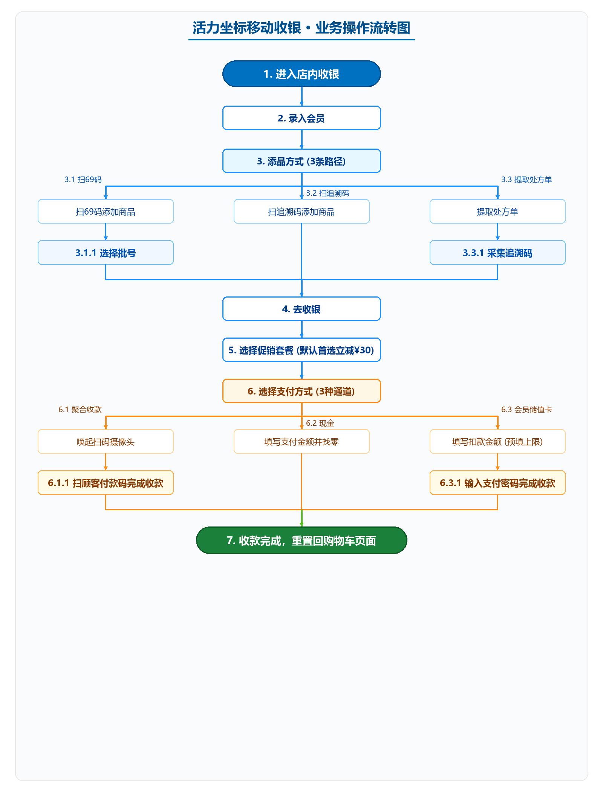

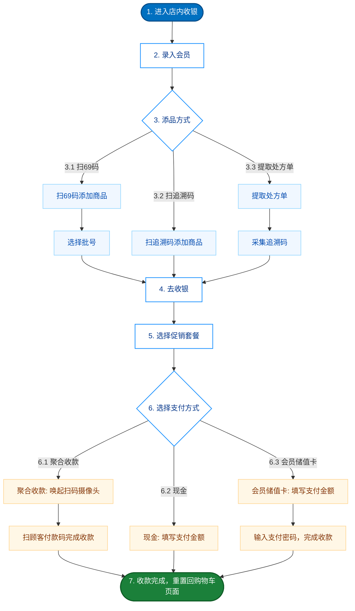

### 2.2 业务操作流转详细说明

| 步骤编号 | 流程步骤 | 细分操作与业务流转说明 | 对应操作界面原型截图 |
| :---: | :--- | :--- | :--- |
| **1** | **进入店内收银** | 打开收银工作台，初始购物车为空置态（0 件、¥0.0），去收银按钮默认禁用，会员处于未绑定状态。 | [图 3-1 初始工作台](#31-工作台初始态与场景定位对应节点-1) |
| **2** | **录入会员** | 键盘输入 11 位会员手机号，系统完成身份校验并在左上角常驻渲染 `[👤 手机号]` 胶囊徽标。 | [图 3-2 会员录入](#32-会员身份智能识别与胶囊交互对应节点-2) |
| **3** | **添品方式** | 支持以下三种核心添药路径： • **3.1 扫69码添加商品** $
ightarrow$ **3.1.1 选择批号**：扫描条码唤起批号半窗，勾选在库有效批次入车； • **3.2 扫追溯码添加商品**：点击【模拟扫追溯码】一键识别 20 位国家码，秒级自动关联批次入车； • **3.3 提取处方单** $
ightarrow$ **3.3.1 采集追溯码**：点击悬浮处方单提取单据，按处方药品数量 1:1 采齐追溯码。 | [图 3-3 扫码选批](#33-药品检索与国家追溯码一键核验对应节点-31--32) [图 3-4 追溯码直通](#33-药品检索与国家追溯码一键核验对应节点-31--32) [图 3-5 处方采集](#34-电子处方单智能管理与追溯码-11-逐盒合规采集对应节点-33) |
| **4** | **去收银** | 处方药采齐追溯码后解锁结算通道，点击底部【去收银】进入收银结算页面。 | [图 3-6 购物车去收银](#35-购物车流转与去收银对应节点-4) |
| **5** | **选择促销套餐** | 结算页默认自动勾选第 1 项最优惠套餐（立减 ¥30.0），支持单选切换或取消，应付总额实时联动抵扣。 | [图 3-7 促销套餐首选](#36-促销套餐自动化首选机制对应节点-5) |
| **6** | **选择支付方式** | 提供三种支付渠道： • **6.1 聚合收款** $
ightarrow$ **6.1.1 扫顾客付款码完成收款**：唤起后置摄像头反扫顾客微信/支付宝条码； • **6.2 现金**：输入实收现金数额，系统自动大字提示找零； • **6.3 会员储值卡** $
ightarrow$ **6.3.1 输入支付密码，完成收款**：填写扣款金额（自动填充可用上限），调起 6 位 PIN 码键盘鉴权扣款。 | [图 3-8 聚合反扫](#37-多元支付结算与反扫闭环对应节点-6) [图 3-9 现金找零](#37-多元支付结算与反扫闭环对应节点-6) [图 3-10 储值卡PIN码](#37-多元支付结算与反扫闭环对应节点-6) |
| **7** | **收款完成，重置回购物车页面** | 扣款核销成功即刻生成 18 位收银流水号，系统自动清空购物车、重置已提处方状态并恢复促销首项优选，平滑切回购物车收银第一现场。 | [图 3-11 结单与重置](#38-交易完成与下一单自动化重置对应节点-7) |

---

## 3. 功能规格详述（附各节点高保真操作界面原型截图）

### 3.1 工作台初始态与场景定位（对应节点 1）
- **场景模式**：系统运行模式固定为“活力坐标”（Vitality Coordinates）标准移动收银模式；
- **冷启动状态**：
  - 购物车商品件数初始为 `0`，总金额显示为 `¥0.0`；
  - 底部【去收银】按钮呈禁用灰阶态（`disabled`），防止产生空单；
  - 会员状态为“未绑定”；
- **全屏扫描视口**：主屏幕呈现 2.4s 循环激光扫描线动效，右上角常驻手电筒补光按键。

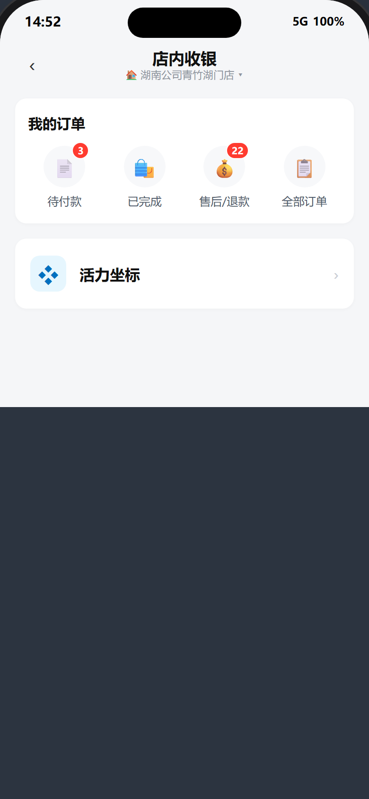
*图 3-1 节点 1：进入店内收银工作台初始态界面*

---

### 3.2 会员身份智能识别与胶囊交互（对应节点 2）
- **输入路由控制**：
  - 店员在数字键盘输入 11 位手机号时，系统判定为录入会员；
  - 录入会员时专门处理会员身份鉴权与状态激活，不触发商品批号弹窗；
- **左上角会员胶囊徽标**：
  - 录入成功后，在屏幕左上角导航返回键右侧高亮常驻展示 `[👤 18510178068]` 胶囊；
  - 点击胶囊徽标唤出操作抽屉：展示会员脱敏姓名（如 `赵**`）、储值卡可用余额，并提供【解绑当前会员】操作；
- **支付侧联动**：
  - 已录入会员时，结算页支付方式网格中呈现【会员储值卡】卡片；未录入会员时仅支持聚合收款和现金。

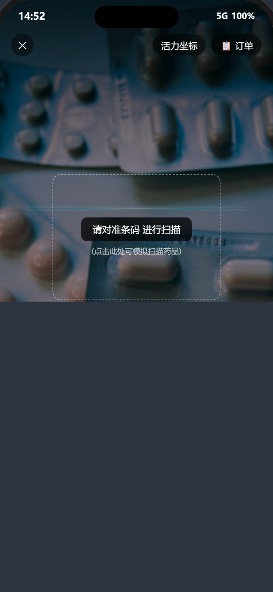
*图 3-2 节点 2：录入会员身份鉴权与九宫格输入*

---

### 3.3 药品检索与国家追溯码一键核验（对应节点 3.1 & 3.2）
- **普通条码模式（节点 3.1）**：扫入 69 码或货号后，唤起底部批号选择半窗，供店员核对在库有效批次、有效期、库存与零售价后，通过 `+` `-` 调节数量添加入车；

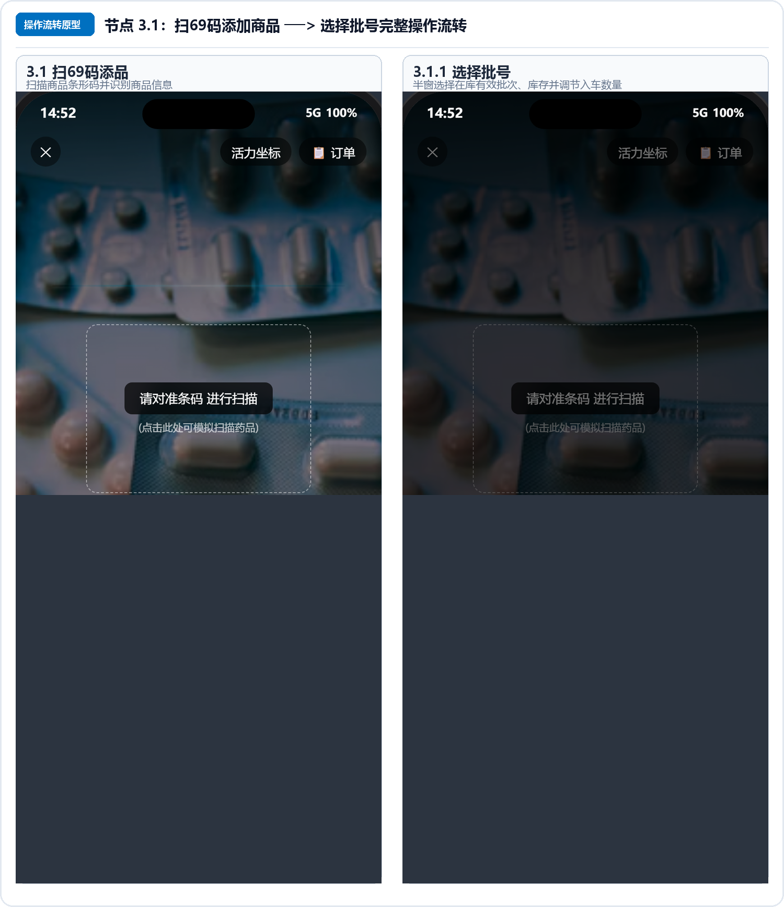
*图 3-3 节点 3.1：扫69码添品与在库批号选择流转*

- **【📸 模拟扫追溯码】直通模式（节点 3.2）**：
  - 数字键盘顶部挂载专属橙色胶囊按钮；
  - 点击后模拟扫描以 `8430` 开头的 20 位国家药品一物一码追溯码（如 `84300298883275088608`）；
  - 系统在线验真后直接绑定在库唯一批次并添加至购物车，实现一步到位的极简操作，免去人工二次选批。

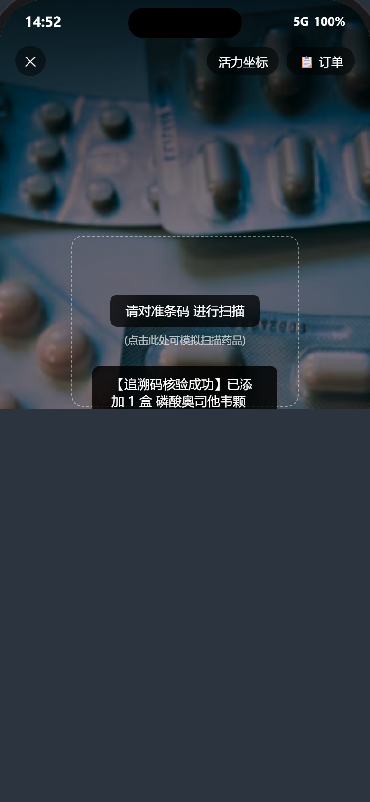
*图 3-4 节点 3.2：扫国家药品追溯码直通入车*

---

### 3.4 电子处方单智能管理与追溯码 1:1 逐盒合规采集（对应节点 3.3）
- **悬浮入口**：扫码主界面右下角悬浮蓝白胶囊 `[💊 处方单]`，配有待提单数量角标；
- **处方卡片信息结构**：
  1. **首要识别区**：加粗放大展示【顾客姓名】（如“王*明”），紧随【性别·年龄】浅蓝胶囊（如“男·46岁”），右侧展示脱敏联系电话；
  2. **诊断核心区**：独占通栏浅蓝高亮底框展示【处方诊断】（如“急性支气管炎伴支原体感染”），便于药师快速审方核对；
  3. **次要归档区**：处方单号与就诊科室位于卡片底部浅灰色微缩呈现；
- **多处方单累加提单**：
  - 支持收银员连续提取多张处方单，所有处方药品合并累加进购物车进行合并结算；
- **1:1 逐盒强采集与闭环拦截**：
  - 提取处方单后自动触发【处方药品追溯码采集】半窗；
  - 处方包含几盒药，必须通过【📸 扫描一盒追溯码】逐盒扫齐 20 位码（如 `2/2 盒`）；
  - **合规拦截机制**：若未采齐，底部主收银按钮显示橙色警示态 `待采追溯码 (X/Y)`，点击强制弹出采集窗，锁定结算通道直至全数采齐。

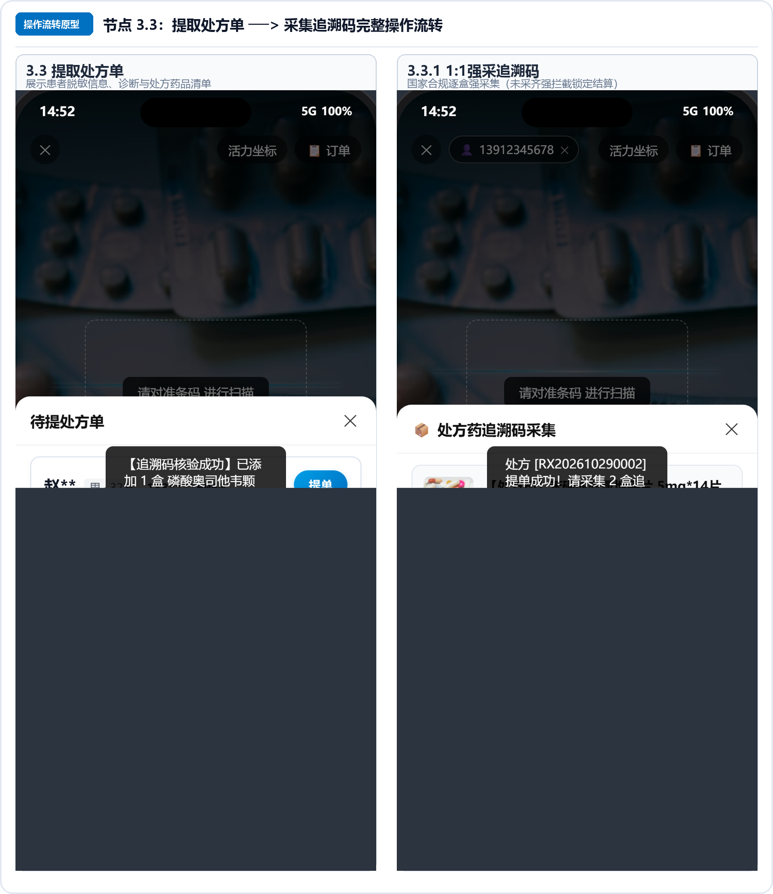
*图 3-5 节点 3.3：提取处方单与追溯码 1:1 逐盒强合规采集流转*

---

### 3.5 购物车流转与去收银（对应节点 4）
- 提供底部购物车半窗，支持查看药品缩略图、品名、在库批号、追溯码摘要及处方药绿/橙色合规状态徽章；
- 支持 `+` / `-` 步进器实时增减及一键清空购物车；
- **通道解锁**：处方药全部采齐追溯码后，底部【去收银 ¥xx.x】解除禁用态，点击平滑进入结算收银台。

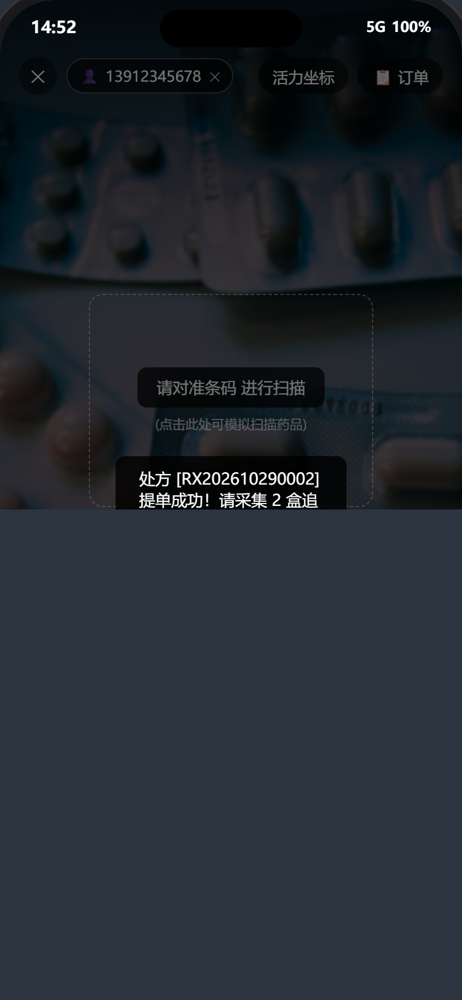
*图 3-6 节点 4：购物车明细核验与解锁去收银*

---

### 3.6 促销套餐自动化首选机制（对应节点 5）
- **界面位置**：结算页【促销套餐 (单选)】卡片组；
- **默认勾选策略**：
  - 页面初次载入及开启新单时，系统默认且自动勾选第 1 项最优惠套餐（“开业盛典全能大礼包 A 立减 ¥30.0”）；
  - 界面单选圆圈高亮展示对勾状态，顶部待收总额与反扫金额动态扣减 ¥30.0；
- **交互控制**：支持单选切换其他套餐，或再次点击已选项取消优惠。

*图 3-7 节点 5：选择促销套餐与金额动态抵扣*

---

### 3.7 多元支付结算与反扫闭环（对应节点 6）
- **聚合收款（反扫顾客码，节点 6.1）**：
  - 点击【确认收款 ¥xx.x】后，立即唤起全屏后置摄像头扫描页面；
  - 屏幕呈现动态激光扫码框与“请对准顾客付款条码或二维码”，反扫成功后即刻核销出票；

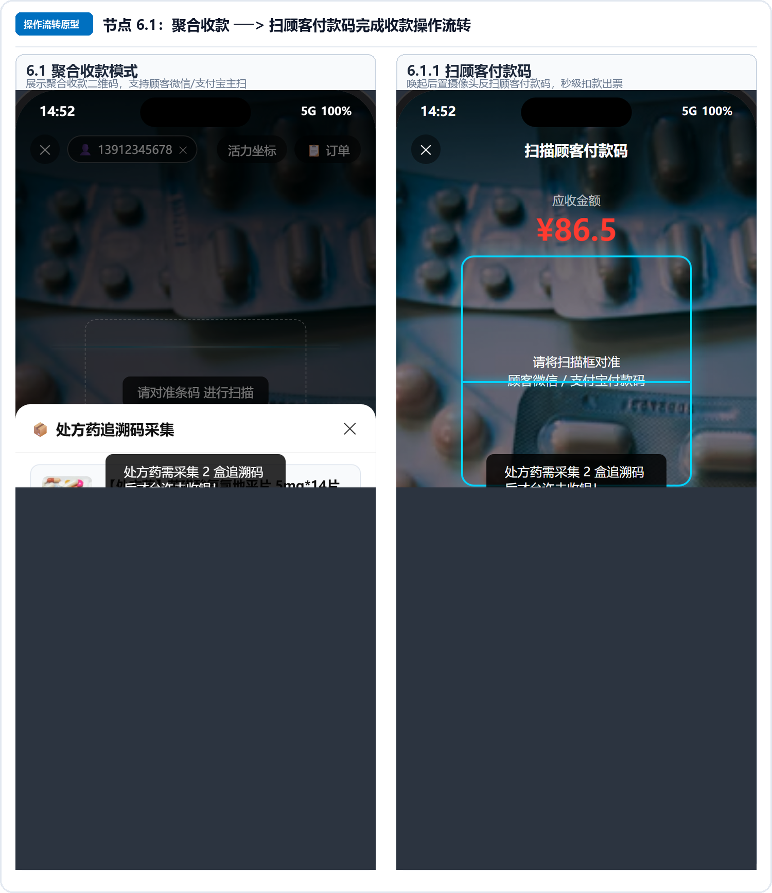
*图 3-8 节点 6.1：聚合收款与反扫顾客付款码流转*

- **现金支付（节点 6.2）**：
  - 切换至现金收款方式，弹出实收现金金额输入框；
  - 实时根据实收金额与应收金额计算找零，以醒目大字展示找零金额（如“找零 ¥7.1”），实收不足时阻断结单；

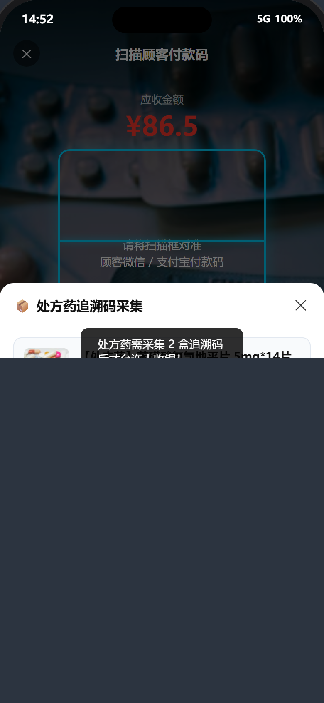
*图 3-9 节点 6.2：现金收款实收输入与找零计算*

- **会员储值卡支付（节点 6.3）**：
  - 面板清晰呈现三项核心信息：**会员脱敏姓名**（`赵**`）、**储值卡可用余额**（`¥150.00`）、**扣款金额输入框**；
  - 扣款金额默认自适应设为：$\min(	ext{当前应付总额}, 	ext{储值卡剩余额度})$；
  - 输入超额时自动纠偏并提示；点击扣款调起 6 位数字支付密码键盘进行安全鉴权；

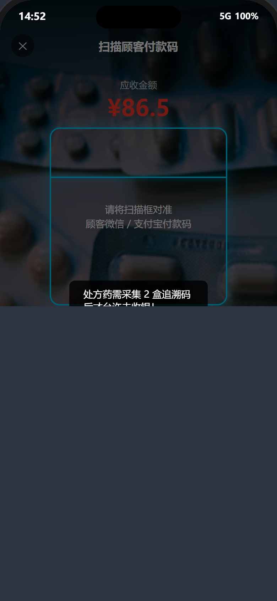
*图 3-10 节点 6.3：会员储值卡扣款与 6 位密码鉴权*

---

### 3.8 交易完成与下一单自动化重置（对应节点 7）
- 交易成功弹出凭据页，生成唯一的 18 位收银流水单号（`898...`）；
- 点击【开启下一单】或【继续收款】主按钮后，系统重置购物车数据、清除已提处方状态，并自动恢复促销套餐默认勾选第一项，平滑切回扫码收银第一现场。

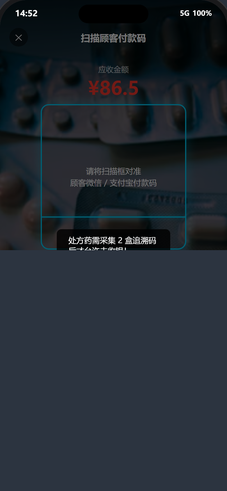
*图 3-11 节点 7：收款完成凭据与一键重置返回购物车*

---

## 4. 业务异常矩阵与防御策略

| 异常情景 / 边界用例 | 系统拦截机制 | 前端用户感知表现 |
| :--- | :--- | :--- |
| **处方药追溯码未采齐** | 物理禁用结算通道，拦截支付请求。 | 底部主按钮高亮橙色【待采追溯码 (X/Y)】；点击弹窗引导一键补采。 |
| **储值卡余额小于待收额** | 截断最高可用金额：Min(待付额, 余额)。 | 自动预填余额上限并 Toast 提示“扣款额已自动设为最大可用余额”。 |
| **现金实收金额不足** | 判定【实收金额 < 应付总额】强阻断。 | 按钮拦截，弹出红底 Toast：“实收金额不足，请核对后再结算”。 |
| **未录入会员选储值卡** | 支付方式网格不予渲染【会员储值卡】。 | 会员卡片无感隐藏，收银员只能选聚合收款或现金。 |
| **已提单处方重复提取** | 处方列表服务端仅返回 PENDING 单据。 | 列表中不可见已提取单据，防止同一张处方流出两批实物药。 |
| **空购物车误触收款** | 底部收银按钮强制设置 disabled 属性。 | 按钮置灰不可点击，避免生成 0 元脏数据流水。 |
